<!--
  Product name: in this file the name appears only in the H1 title just below and in image alt
  texts; everything else says "the app". The screenshots and the demo GIF show the name in the
  app's toolbar, so a rename also means re-running `node scripts/capture/capture.mjs`.
-->

<p align="center">
  
</p>

<h1 align="center">SparkBench</h1>

<p align="center">
  <b>Draw a circuit, watch it run live on real SPICE, and take it to KiCad — in one desktop app.</b>
</p>

<p align="center">
  <a href="https://github.com/kingrebelf/Spark-bench/actions/workflows/ci.yml"></a>
  <a href="LICENSE"></a>
  
  
  
</p>

<p align="center">
  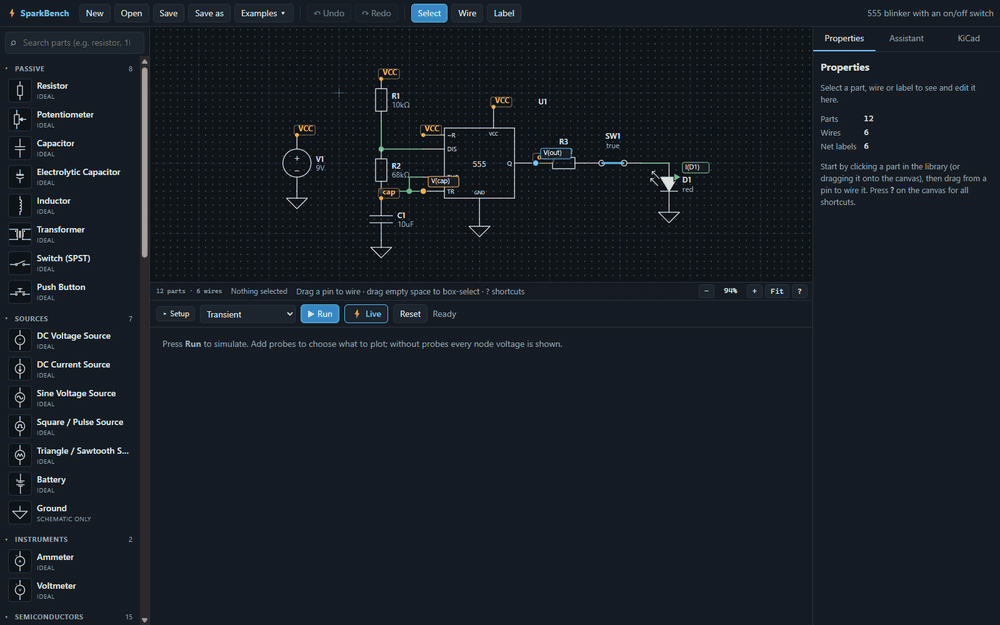
  <br><sub>Live mode in real time: the 555 blinks the LED, the scope scrolls, and clicking SW1 re-simulates the circuit with the switch open, then closed.</sub>
</p>

The app is a schematic editor and circuit simulator for people who want to *see* a circuit work and
trust what they see. Every waveform comes from **ngspice**, the open-source SPICE engine, compiled to
WebAssembly. It runs locally with nothing extra to install. Press **⚡ Live**: LEDs glow with their
simulated current, the scope scrolls in real time, switches and potentiometers work on the schematic, and
a part that is driven past its rating visibly burns out and tells you how to fix the design. When a
simulation can't run, the app says why in plain language and names the parts involved. It never draws a
made-up waveform. Finished designs export to **KiCad 10** with the connectivity checked by KiCad itself,
and an optional **AI assistant** proposes changes. ngspice verifies each proposal before you decide.

## Contents

- [Features](#features)
- [Screenshots](#screenshots)
- [Download / build the Windows app](#download--build-the-windows-app)
- [Run from source](#run-from-source)
- [Your first circuit](#your-first-circuit)
- [Simulation](#simulation)
- [Live mode](#live-mode)
- [KiCad workflow](#kicad-workflow)
- [AI assistant](#ai-assistant)
- [Project files](#project-files)
- [Architecture](#architecture)
- [Known limitations](#known-limitations)
- [Roadmap](#roadmap)
- [Contributing](#contributing)
- [License](#license)

## Features

- **Schematic editor**: a searchable library of 51 parts (passives, sources, instruments, diodes and LEDs,
  BJTs and MOSFETs, op-amps, logic, a 555, connectors), wiring on a 50 mil grid that matches KiCad, net labels,
  undo/redo, autosave and crash recovery. There are 11 ready-to-run examples in **Examples ▾**.
- **Real SPICE simulation**: DC operating point, transient and AC (Bode) analyses run by ngspice 45 in a
  background worker. Results map back to your net names and part references.
- **Live mode**: real-time playback with a time-scale dial (100 ns/s to 10 s/s), glowing LEDs, operable
  switches, push buttons and potentiometers, a scrolling scope, and component damage modeling.
- **Scope**: probes on any net or part current, cursors with Δ readouts, min/max/avg/RMS/pk-pk/frequency per
  trace, zoom and pan, and CSV, PNG and netlist export.
- **Diagnostics instead of mystery failures**: design checks before every run catch a missing ground,
  floating pins, missing DC paths and duplicate references. ngspice errors are classified and explained with a
  suggested fix.
- **Honest part models**: every part shows where its behavior comes from: *ideal*, *generic* (typical
  parameters, e.g. "2N3904-like") or *behavioral* (a macromodel). No built-in part claims to be a
  manufacturer's model.
- **KiCad 10 export and import**: a complete KiCad project with schematic and optional PCB. KiCad's own
  ERC, netlist comparison and DRC run after every export. KiCad schematics import as new projects.
- **AI assistant (optional)**: Anthropic, OpenAI, any OpenAI-compatible server (LM Studio, Ollama), or the
  Codex CLI with your ChatGPT sign-in. Proposals are laid out, design-checked and simulated before you apply
  or reject them, and applying one is a single undoable step.

## Screenshots

| | |
|---|---|
| 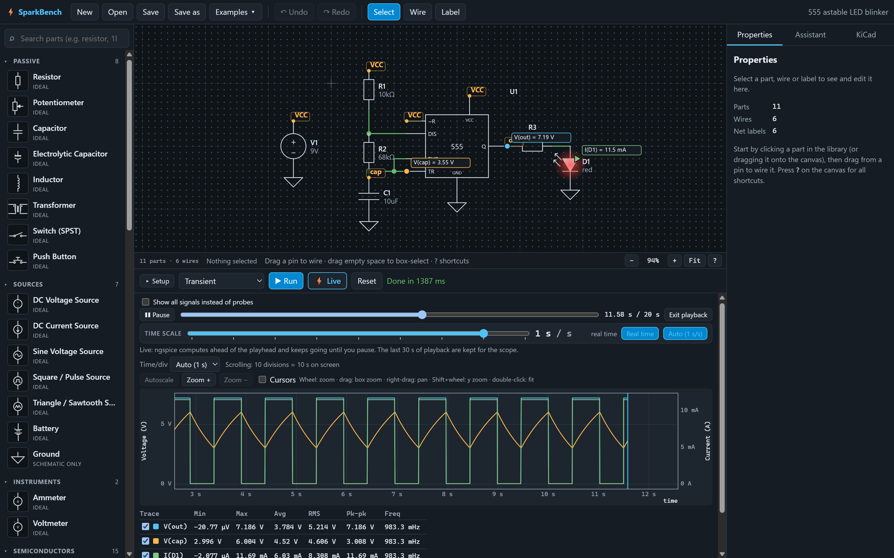 | 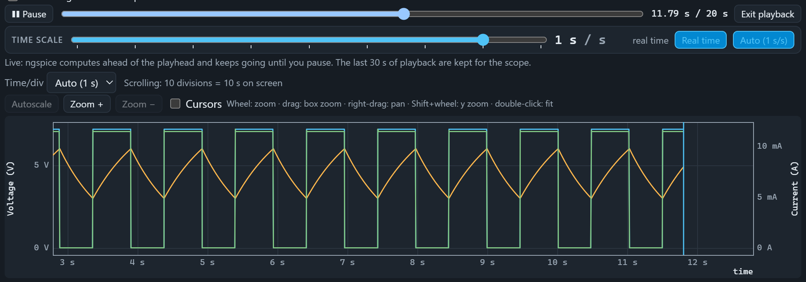 |
| **Live mode**: the 555 blinker in real time. The LED glows with its simulated current, and probe values update on the schematic. | **Time scale and scope**: 1 s of circuit time per second, a 10-division scrolling window, and per-trace measurements. |
| 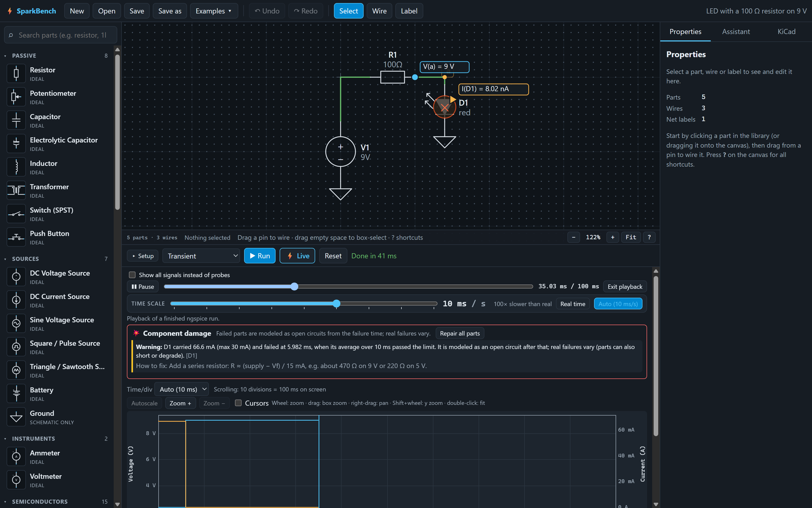 | 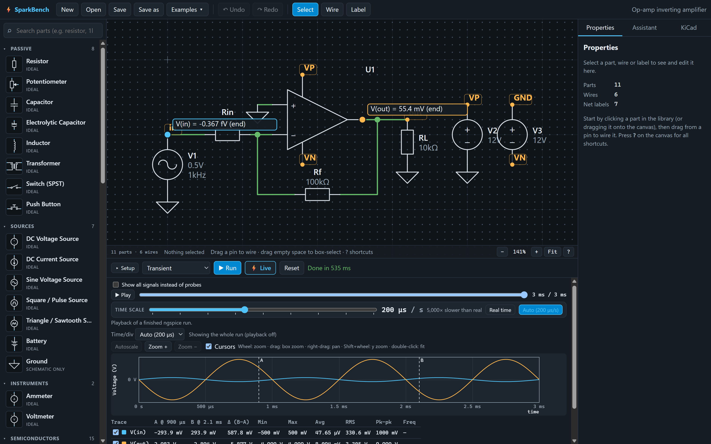 |
| **Component damage**: with 100 Ω on 9 V the LED carries 67 mA (rated 30 mA). It fails, is re-simulated as an open circuit, and the fix is sized for you. | **Transient analysis with cursors**: an inverting amplifier with gain −10, with A/B cursors and Δ readouts. |
| 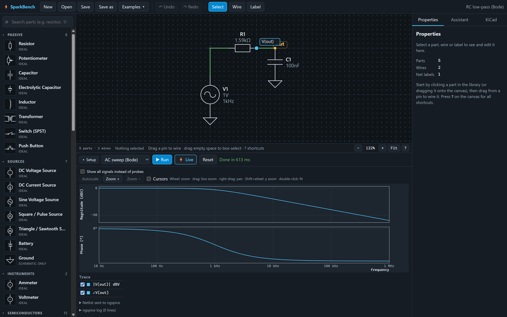 | 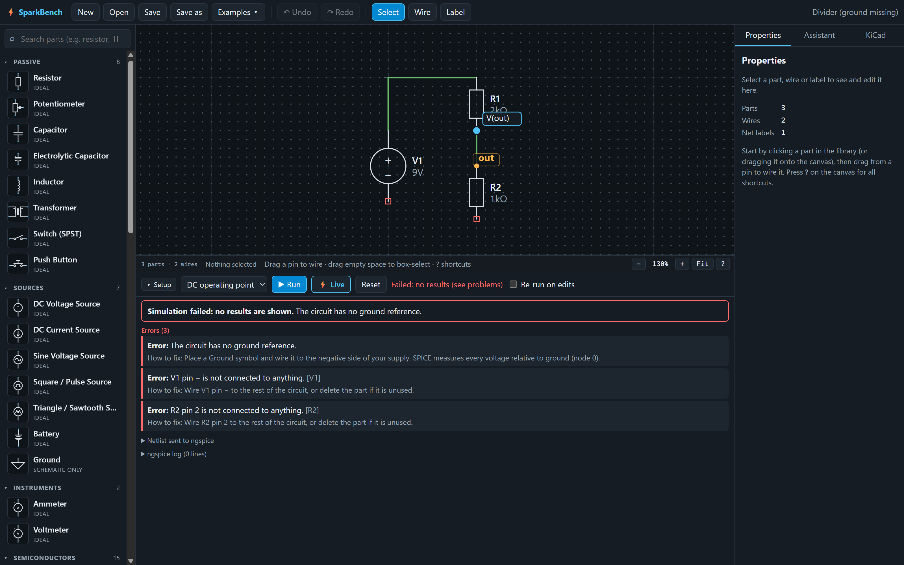 |
| **AC sweep**: Bode magnitude and phase of an RC low-pass, 10 Hz to 1 MHz. | **Diagnostics**: a forgotten ground is caught before simulation, and each problem names the part and the fix. |
| 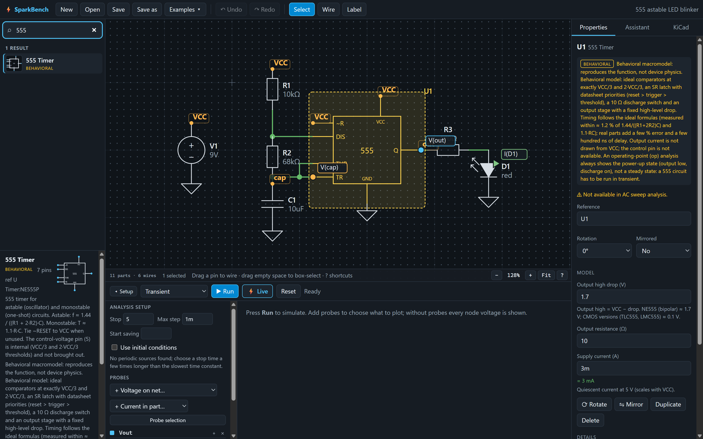 | 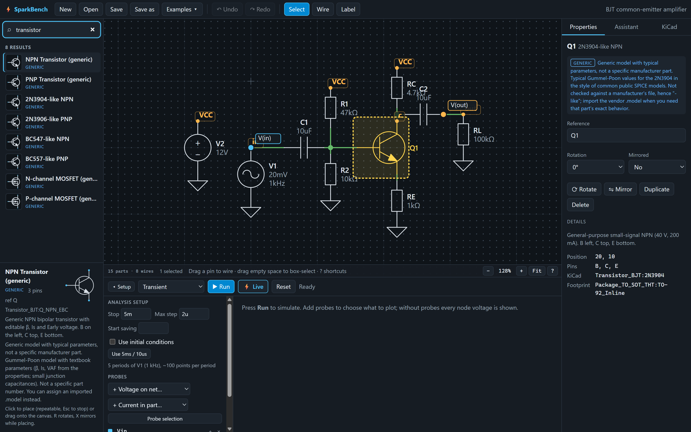 |
| **Properties**: every part states its provenance and accuracy, e.g. the 555's behavioral model. | **Library**: search by name or keyword. Generic parts say what they are and aren't. |
| 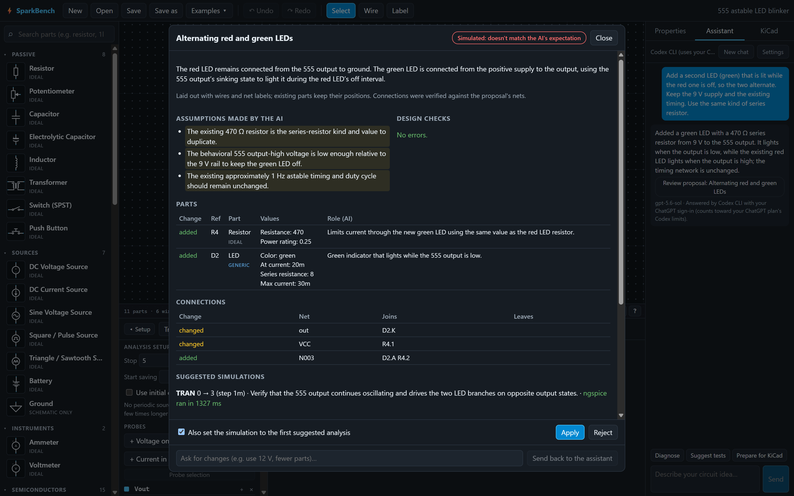 | 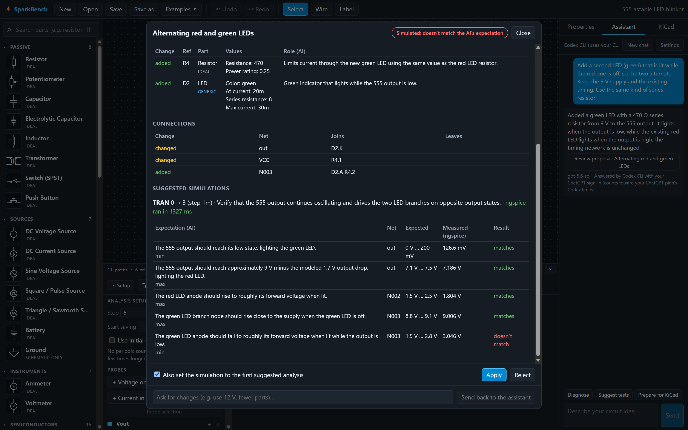 |
| **AI review**: a real Codex reply proposing a second, alternating LED, shown as a diff before anything changes. | **AI claims, checked**: ngspice measures each expectation. Here one of the AI's ranges was wrong, and the review says so. |
| 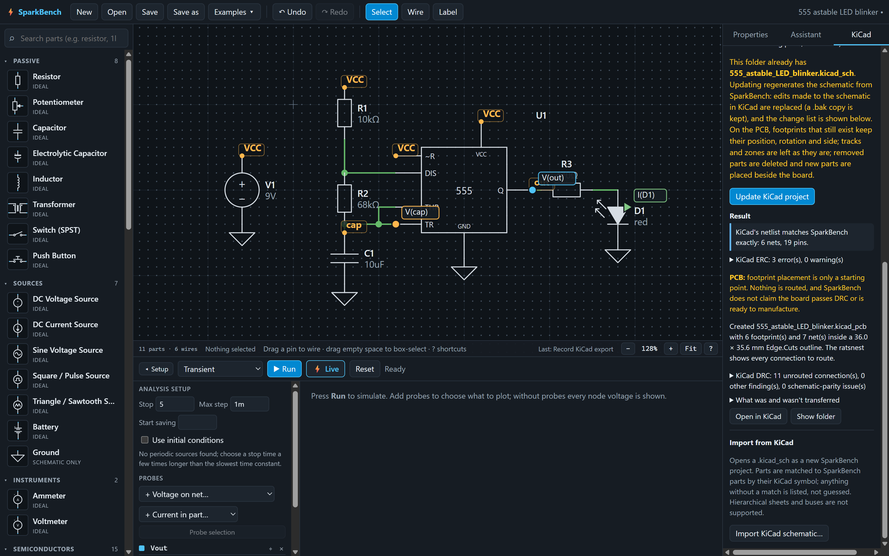 | 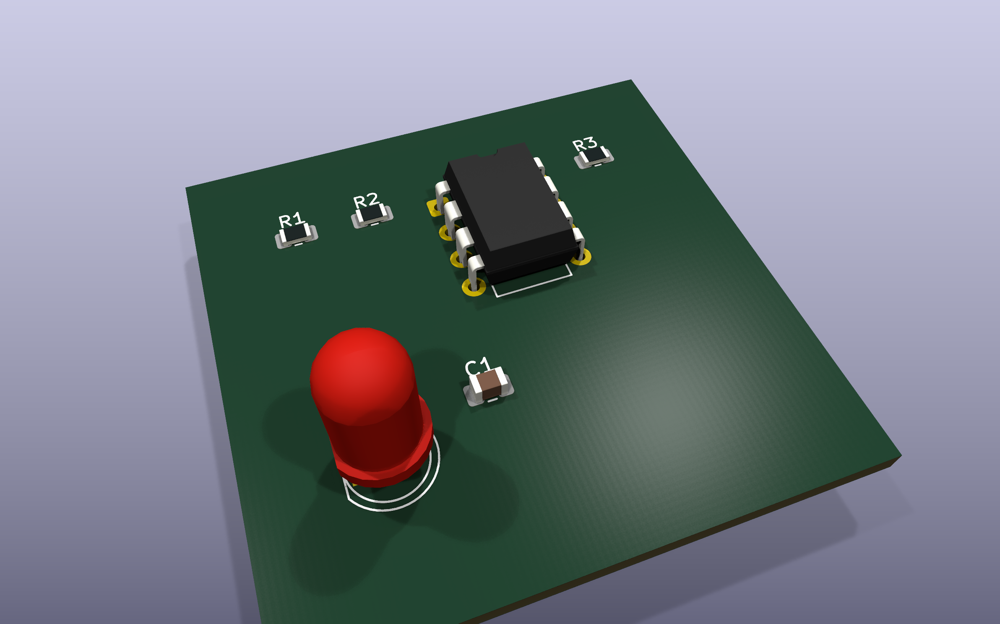 |
| **KiCad export**: KiCad's own netlist matches the schematic exactly, and ERC/DRC findings are shown as-is. | **Generated PCB** (rendered with `kicad-cli pcb render`): footprints placed as a starting point, not routed. |

## Download / build the Windows app

There is no prebuilt download yet. Build the installer yourself (Windows, Node 20+):

```bash
git clone https://github.com/kingrebelf/Spark-bench.git
cd Spark-bench
npm install
npm run dist:win
```

This writes two files to `release/`:

| File | What it is |
|---|---|
| `SparkBench-Setup-0.1.0.exe` | Installer (per-user, choice of folder, Start menu and desktop shortcuts) |
| `SparkBench-0.1.0-portable.exe` | Portable app, no installation |

The builds are **not code-signed**, so Windows SmartScreen warns on first launch. Choose **More info →
Run anyway** if you built it yourself or trust the source. `npm run dist:dir` builds an unpacked folder
for quick testing.

## Run from source

**Requirements**

- [Node.js](https://nodejs.org/) 20 or newer
- Windows 10/11 (tested). macOS and Linux should run from source but haven't been tested yet.
- Optional: [KiCad 10](https://www.kicad.org/download/) for the KiCad panel
- Optional: an AI provider (see [AI assistant](#ai-assistant))

```bash
npm install
npm run dev        # desktop app with hot reload
```

| Command | What it does |
|---|---|
| `npm run dev` | Desktop app (Electron) with hot reload |
| `npm run dev:web` | Renderer only, in a browser at <http://localhost:5183> (no file dialogs, KiCad or AI) |
| `npm test` | 438 tests (vitest), including real ngspice runs; KiCad tests skip without KiCad |
| `npm run typecheck` | TypeScript check |
| `npm run build` | Production build into `dist/` and `dist-electron/` |
| `npm start` | Build, then run the production app |
| `npm run dist:win` | Windows installer and portable exe (see above) |

## Your first circuit

1. **Open an example or start fresh.** **Examples ▾ → LED with series resistor** gives you a working circuit. To build
   it yourself, click *DC Voltage Source*, *Resistor*, *LED* and *Ground* in the library and click the canvas to
   place each. **R** rotates and **X** mirrors while placing.
2. **Wire it.** Drag from a pin to another pin. Connect + → resistor → LED anode, and the LED cathode and the
   source − to ground. Press **?** on the canvas for all shortcuts.
3. **Set values.** Select a part and edit it in **Properties**. Values accept SI prefixes
   (`p n u m k MEG G`, e.g. `330`, `4.7k`, `100n`).
4. **Run.** Choose *DC operating point* and press **▶ Run**. Voltages and currents appear on the schematic.
5. **Go live.** Press **⚡ Live**. The LED glows with its simulated current. Change the resistor to 10 Ω and
   go live again to watch it burn out, and read the suggested fix.
6. **Save** with **Ctrl+S**. Projects are single files.

## Simulation

- **Engine:** ngspice 45 compiled to WebAssembly ([eecircuit-engine](https://www.npmjs.com/package/eecircuit-engine)),
  running in a Web Worker. Results are the same on every machine, and nothing else needs installing.
- **Analyses:** DC operating point, transient, and AC small-signal sweeps (Bode magnitude and phase).
- **Pipeline:** design checks → netlist → ngspice → message classification → results mapped back to net
  names and part references. The netlist and the ngspice log are one click away under the results.
- **No invented results.** A parse error, singular matrix, timestep failure or unknown model fails the run
  visibly with an explanation. On a floating circuit ngspice still returns zeros after a "singular matrix"
  warning; the app treats that as an error rather than plotting the zeros.
- **Model provenance**, shown on every part:
  - *ideal*: a textbook SPICE element (R, L, C, ideal sources and switches).
  - *generic*: a SPICE model with typical or fitted parameters, not a manufacturer's file (named parts are
    called "2N3904-like", "LM358-like").
  - *behavioral*: a macromodel built from behavioral sources that reproduces the function, not the device
    physics. Logic gates, flip-flops, the counter, the 555 and the op-amps are behavioral, because the
    WebAssembly build of ngspice has no XSPICE digital models.
  - Projects can carry their own `.model` / `.subckt` cards, and those travel with the file.

**Accuracy.** SPICE is only as good as its models. Ideal and generic parts suit learning, filter design and
checking a topology. The 555's timing matches 1.44/((R1+2R2)·C) within about 1.2 %, but propagation delays
and supply current aren't modeled. Use a manufacturer's model before trusting margins on real hardware.

## Live mode

**⚡ Live** turns a transient analysis into something you watch and operate:

- **Real-time playback** with a time-scale dial in 1-2-5 steps from 100 ns/s to 10 s/s and a *Real time*
  detent. *Auto* picks a rate from the circuit, e.g. about two periods of the slowest source per second.
  Changing the rate never changes the simulation, only how fast you watch it.
- **Continuous runs:** ngspice computes ahead of the playhead in the background, and the scope keeps the last
  30 s of playback. If the engine falls behind, playback waits ("Computing…") instead of looping or skipping.
- **Operate the circuit:** click switches, hold push buttons and drag potentiometers on the schematic while it
  plays. Each change is recorded at its playback time and the circuit is re-simulated from 0 s with all your
  changes, so what you see is always a complete ngspice solution.
- **Glow and damage:** LEDs light with their simulated current. Resistors (power), capacitors (voltage,
  reverse voltage for electrolytics), LEDs and diodes (current) and Zeners (power) have ratings. Above 70 %
  of a rating a part glows amber. When its averaged stress passes the limit, it fails: you see a flash, smoke
  and a char mark, the circuit is re-simulated with the part open from that moment, and the message sizes
  the fix (e.g. "use a ≥ 3 W resistor, or at least 860 Ω"). **Repair all parts** puts them back.

The engine can't pause mid-run. Pause applies to playback of computed results, and *Stop* ends the worker.

## KiCad workflow

The **KiCad** panel targets **KiCad 10.0.x** (developed and tested with 10.0.6 on Windows). It finds a
standard installation automatically, or set `SPARKBENCH_KICAD_DIR`. Without KiCad, the panel says so and
everything else works.

- **Mapping review:** every part maps to a KiCad symbol and footprint (e.g. `Device:R` +
  `Resistor_SMD:R_0805_2012Metric`). The panel checks that symbols and footprints are installed and that pin and pad
  numbers line up, and lets you search the installed libraries to pick another.
- **Export:** writes `<name>.kicad_pro`, `.kicad_sch` and, optionally, `.kicad_pcb`. Symbols come from your
  installed KiCad libraries, pins stay on KiCad's 50 mil grid, and SPICE fields are filled in for KiCad's own
  simulator where possible.
- **Verification after every export:** `kicad-cli` runs ERC, exports KiCad's netlist and compares it net by
  net with the app's ("matches exactly" or a list of differences), and runs DRC with schematic parity.
  Findings are shown as KiCad reports them.
- **PCB as a starting point:** KiCad's `pcbnew` places the footprints in rows that follow the schematic,
  inside a board outline. **Nothing is routed.** The app doesn't claim the board passes DRC or is ready to
  manufacture.
- **Update an existing project:** re-exporting into the same folder regenerates the schematic (with a `.bak`
  copy), reports what changed, and keeps footprint positions, tracks and zones on the PCB.
- **Import:** opens a `.kicad_sch` (KiCad 9 or 10) as a new project. Symbols with a matching library part are
  imported; anything else is listed, never guessed.

Exported files use KiCad 10's formats and don't open in KiCad 9 or older. Details: [docs/kicad.md](docs/kicad.md).

## AI assistant

The **Assistant** tab turns a plain-language idea ("drive a red LED from 12 V") or an edit request into a
**proposal**. The model never edits your schematic. It returns parts and nets, which the app checks
against the library, lays out with verified connectivity, runs through the design checks, and simulates in
ngspice against the model's own numeric expectations. You see a diff of parts and connections, the AI's
assumptions, and each expected value next to what ngspice measured, then **Apply** (one undo step),
**Reject**, or send it back with comments. The assistant asks questions instead of guessing when a
requirement that matters is missing. **Diagnose**, **Suggest tests** and **Prepare for KiCad** are
one-click actions.

| Provider | What you need |
|---|---|
| **Anthropic API** | An API key from console.anthropic.com (default model `claude-opus-5-5`) |
| **OpenAI API** | An API key from platform.openai.com |
| **OpenAI-compatible** | A server such as LM Studio or Ollama; the key is optional |
| **Codex CLI** | The [Codex CLI](https://github.com/openai/codex) installed and signed in with ChatGPT; no API key |

- **Keys are stored with OS encryption** (Electron `safeStorage`, DPAPI on Windows) and decrypted only in
  the main process. The UI only ever learns whether a key is set. If OS encryption is unavailable, the key
  isn't stored at all; there is no plaintext fallback.
- **About the Codex option:** it runs `codex exec` on your machine, in a read-only sandbox and an empty
  temporary folder, and uses your existing ChatGPT sign-in. Usage counts toward your ChatGPT plan's Codex
  limits, and replies take about 15–60 s. It isn't API access. A ChatGPT or Claude.ai subscription doesn't
  include API keys; the Anthropic and OpenAI providers need separately billed API keys.
- **What is sent:** your request, the library catalog, and the current circuit as nets. *Diagnose* also sends
  the current diagnostics and the last result. Nothing is sent until you ask.

Details, including what was and wasn't verified against live services: [docs/ai.md](docs/ai.md).

## Project files

A project is one human-readable JSON file (`.sbproj`), validated on load. It holds the schematic,
simulation settings and probes, any SPICE models the project uses (so it opens on another machine without
missing models), and KiCad mapping overrides. Opening never fails silently: invalid JSON, unknown parts and
missing models are reported as diagnostics and kept in the file. Unsaved work is autosaved for crash recovery.

Specification: [docs/project-format.md](docs/project-format.md). Parts and models: [docs/library.md](docs/library.md).

## Architecture

```
Electron main (Node)                        Renderer (React 19 + TypeScript)
  windows, files, recovery         ◄─IPC─►    app shell · editor · library · properties
  kicad-cli + pcbnew (KiCad)        sb:*      simulation panel · live mode · scope
  AI providers, keys, Codex                   KiCad panel · AI assistant
                                                 │ postMessage
                                              Web Worker: ngspice 45 (WebAssembly)
```

- **Electron** for real file access, OS-encrypted credential storage, and running `kicad-cli`, KiCad's
  Python and `codex` locally. The renderer is sandboxed and IPC is limited to `sb:<area>:` channels.
- **React + zustand/immer**: every schematic edit is an immer patch, so editor actions, AI proposals and
  imports share one undo history.
- **SVG canvas** for crisp symbols at any zoom.
- **`src/core`** holds the UI-free contracts: types, file format, connectivity, design checks, netlist,
  simulation.

More: [docs/architecture.md](docs/architecture.md).

## Known limitations

- Digital parts, the 555 and op-amps are behavioral analog models, not XSPICE digital models or vendor models.
- No built-in manufacturer models. Projects can store `.model`/`.subckt` text, but there is no import button
  in the UI yet.
- Live re-simulation starts from 0 s on every change, so compute time grows with run length. At real time a
  555 circuit stays ahead for roughly 20 minutes, then playback waits for the engine.
- Live switch and pot changes and burnouts aren't saved in the project file or the undo history.
- KiCad: single-sheet schematics only; exported files need KiCad 10; the PCB is placed, not routed.
- Windows is the only tested and packaged platform, and the builds are unsigned.
- The file format may still change before 1.0 (files will be migrated, not silently broken).

## Roadmap

- Import SPICE models from the UI, and more parts
- Faster long live runs (continue from saved state instead of re-simulating from 0 s)
- DC sweep, parameter sweep and Monte Carlo analyses
- Signed builds, plus tested macOS and Linux packages
- Hierarchical sheets and buses (editor and KiCad)

## Contributing

Issues and pull requests are welcome. Before opening a PR:

```bash
npm run typecheck
npm test
```

- Read [docs/architecture.md](docs/architecture.md) first. Shared contracts live in `src/core`.
- Schematic edits go through `useProject.getState().update(label, draft => …)` so they can be undone.
- Every user-facing problem is a `Diagnostic` with the affected part ids and a plain-language fix.
- New parts declare their provenance, and their pin positions match the KiCad symbol (a test checks this
  against your KiCad install).
- The README images are generated by `node scripts/capture/capture.mjs`. It drives the real desktop app
  through Playwright with a throwaway profile, needs KiCad for the KiCad shots and `ffmpeg` on PATH for the
  GIF, and replays a recorded Codex reply for the AI shots (`--record-ai` records a new one).

## License

[MIT](LICENSE) © 2026 kingrebelf

ngspice is used through [eecircuit-engine](https://www.npmjs.com/package/eecircuit-engine) under its own
license. KiCad is a separate application under the GPL; the app talks to it through `kicad-cli`, KiCad's
Python module and its file formats, and doesn't bundle it. The app icon was generated with ChatGPT's image
generation.
