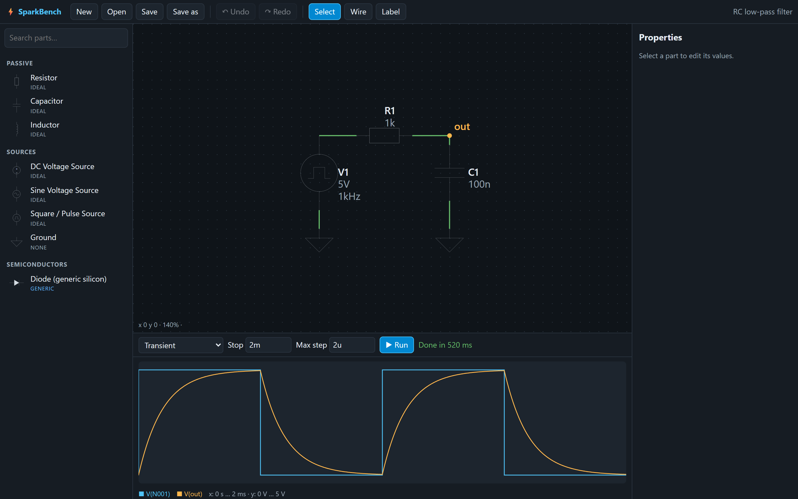

<!--
  Product name: the name appears only in the H1 title just below, the image alt texts, and the
  "Project files" section (the .sbproj extension). To rename, edit those lines; everything
  else says "the app".
-->

<h1 align="center">SparkBench</h1>

<p align="center">
  <b>Draw a circuit, simulate it with real SPICE, and take it to KiCad — in one desktop app.</b>
</p>

<p align="center">
  <a href="https://github.com/kingrebelf/Spark-bench/actions/workflows/ci.yml"></a>
  <a href="LICENSE"></a>
  
  
</p>

<p align="center">
  
</p>

The app is a schematic editor and circuit simulator for people who want answers they can trust. The
simulator is **ngspice**, the open-source SPICE engine, compiled to WebAssembly. It runs locally with
nothing extra to install. When a simulation can't run, the app says why in plain language and points
at the parts involved. It never shows a made-up waveform. Finished designs export to **KiCad** for
PCB layout, and an optional **AI assistant** can review a circuit and propose changes. Every change
it proposes waits for your approval.

> **Status:** early development. The core pipeline (editor → netlist → ngspice → scope) works today;
> KiCad and AI features are landing now. Expect rough edges and breaking changes to the file format
> before 1.0.

## Contents

- [Features](#features)
- [Screenshots](#screenshots)
- [Quick start](#quick-start)
- [Your first circuit](#your-first-circuit)
- [Simulation](#simulation)
- [KiCad workflow](#kicad-workflow)
- [AI assistant](#ai-assistant)
- [Project files](#project-files)
- [Architecture](#architecture)
- [Known limitations](#known-limitations)
- [Roadmap](#roadmap)
- [Contributing](#contributing)
- [License](#license)

## Features

<!-- TODO-final: confirm against the merged app (editor, sim, library, KiCad, AI sessions) -->

- **Schematic editor**: place parts from a searchable library, wire on a 50 mil grid with T-junctions,
  name nets with labels. Undo/redo, autosave and crash recovery.
- **Real SPICE simulation**: operating point, transient and AC analyses run by ngspice 45 in a background
  worker, so the UI stays responsive and a run can be stopped at any time.
- **Oscilloscope and Bode views**: probe any net, read values with cursors, sweep frequency on log axes.
- **Diagnostics instead of mystery failures**: before every run, design checks catch a missing ground,
  floating pins, missing DC paths and duplicate references, and name the parts involved. ngspice errors
  are classified and explained with a suggested fix.
- **Honest part models**: every part says where its behavior comes from: *ideal*, *generic*,
  *behavioral* or *vendor* model. The app never claims a part matches a specific real device unless
  it uses that manufacturer's model.
- **KiCad 10 interoperability**: export the schematic with KiCad symbols and footprints, generate a
  board, and import KiCad schematics.
- **AI assistant (optional)**: ask questions about your circuit, get a design review, or let it
  propose edits that you inspect and apply (or reject) as one undoable step.

## Screenshots

<!-- TODO-final: regenerate with `node scripts/capture/capture.mjs` against the merged app; add KiCad + AI shots -->

| | |
|---|---|
|  |  |
| **Schematic editor**: parts library on the left, canvas in the middle, properties on the right. | **Transient analysis**: input square wave and filtered output, computed by ngspice. |
|  |  |
| **AC sweep**: Bode magnitude of the same filter, 10 Hz to 1 MHz. | **Diagnostics**: a missing ground is caught before simulation, with the fix spelled out. |
|  |  |
| **Properties**: edit values with SI units; every part shows its model provenance. | **Library**: search parts by name or keyword. |

## Quick start

**Requirements**

- [Node.js](https://nodejs.org/) 20 or newer (includes npm)
- Windows 10/11, macOS 12+, or a recent Linux desktop
- Optional: [KiCad 10](https://www.kicad.org/download/) for the KiCad export/PCB tools
- Optional: an API key for an AI provider, or the Codex CLI signed in to ChatGPT (see [AI assistant](#ai-assistant))

```bash
git clone https://github.com/kingrebelf/Spark-bench.git
cd Spark-bench
npm install
npm run dev        # start the desktop app with hot reload
```

| Command | What it does |
|---|---|
| `npm run dev` | Desktop app (Electron) with hot reload |
| `npm run dev:web` | Renderer only, in the browser at <http://localhost:5183> (no file system, KiCad or AI key storage) |
| `npm test` | Unit and integration tests (vitest), including real ngspice runs |
| `npm run typecheck` | TypeScript type check |
| `npm run build` | Production build into `dist/` and `dist-electron/` |
| `npm start` | Build, then run the production app |

<!-- TODO-final: packaged installers (if the build gains electron-builder) -->

## Your first circuit

<!-- TODO-final: match final editor interactions (drag from library, rotate key, probe tool) -->

This builds the RC low-pass filter from the animation above.

1. **Place parts.** In the library, pick *Square / Pulse Source*, *Resistor*, *Capacitor* and
   two *Ground* symbols, and drop them on the canvas.
2. **Wire them.** Press **W** (or click *Wire*), click a pin, then click the next pin. Connect
   source + → R1 → C1 → ground, and the source − to ground.
3. **Name the output.** Use *Label* to name the R1–C1 node `out`.
4. **Set values.** Select R1 and set it to `1k`, and C1 to `100n`. Values accept SI prefixes
   (`p n u m k MEG G`).
5. **Simulate.** In the simulation bar choose *Transient*, *Stop* `2m`, and press **Run**. The scope
   shows the square wave and the exponential charge/discharge at `out` (τ = RC = 100 µs).
6. **Sweep frequency.** Switch the source to a sine source (AC magnitude 1), choose *AC sweep* from
   10 Hz to 1 MEG, and press **Run** for the Bode plot. The −3 dB point lands at
   f = 1/(2πRC) ≈ 1.59 kHz.
7. **Save** with **Ctrl+S**. Projects are single `.sbproj` files.

## Simulation

<!-- TODO-final: analyses list, cursor/measurement features, playback controls from the sim session -->

- **Engine:** ngspice 45 compiled to WebAssembly ([eecircuit-engine](https://www.npmjs.com/package/eecircuit-engine)),
  running in a Web Worker. Results are identical on every machine and nothing needs installing.
- **Analyses:** DC operating point (`.op`), transient (`.tran`), and small-signal AC (`.ac`) frequency sweeps.
- **Pipeline:** design checks → netlist generation → ngspice → message classification → results mapped
  back to your net names and part references.
- **No invented results.** If ngspice reports a parse error, singular matrix, timestep failure or
  unknown model, the run fails visibly with an explanation. On a floating circuit ngspice still returns
  zeros after a "singular matrix" warning; the app treats that as an error rather than plotting the zeros.
- **Model provenance.** Each part is labeled:
  - *ideal*: an exact SPICE primitive (R, L, C, ideal sources).
  - *generic*: a typical model for a class of device (e.g. a generic silicon diode), not a specific part number.
  - *behavioral*: built from behavioral sources and switches to reproduce logic-level behavior.
  - *vendor*: the manufacturer's published SPICE model, with its source recorded in the project.
- **Stopping a run:** the engine can't pause partway through a run. *Stop* ends the worker
  immediately. Pause and speed controls apply to playback of results that have already been computed.

**Accuracy and limits.** SPICE is only as accurate as its models. Ideal and generic parts are right for
learning, filter design and topology checks. Use vendor models before trusting margins on real hardware.
Digital logic and timers such as the 555 are **behavioral analog models**: ngspice's XSPICE digital
code models aren't available in the WebAssembly build. They reproduce thresholds and timing well enough
for most circuits, but they don't model propagation delays or supply current the way a vendor model would.

## KiCad workflow

<!-- TODO-final: take facts from docs/kicad.md (export/import scope, symbol/footprint mapping, PCB generation, kicad-cli usage) -->

> *In progress: this section describes the KiCad features being built now.*

The app targets **KiCad 10** (schematic file format `20250610`).

- **Export:** each part maps to a KiCad symbol and footprint (e.g. `Device:R` +
  `Resistor_SMD:R_0603_1608Metric`). You can override the mapping per part, and an export panel lists
  every mapping and anything it couldn't map.
- **PCB:** with KiCad installed, the app uses `kicad-cli` to produce a board with footprints and
  netlist ready for placement and routing in KiCad's PCB editor.
- **Import:** open a KiCad schematic. Parts the library knows become simulatable; anything else is kept
  and reported as a diagnostic.

KiCad is optional. Everything except the KiCad tools works without it. The app finds a standard
KiCad 10 installation automatically. <!-- TODO-final: how to point it at a custom install -->

## AI assistant

<!-- TODO-final: take facts from docs/ai.md (providers, models, key storage, Codex option, privacy) -->

> *In progress: this section describes the assistant being built now.*

The assistant is **off until you configure it**, and it never edits your design by itself. It
**proposes** changes. You see a diff of the parts, wires and values it wants to change, and applying it
is one undoable step.

- **Providers:** bring your own API key for a supported provider. Keys are stored with the operating
  system's encryption (Electron `safeStorage`: DPAPI on Windows, Keychain on macOS, libsecret on Linux)
  and never written to project files or logs.
- **Codex / ChatGPT option:** if you have the [Codex CLI](https://github.com/openai/codex) installed and
  signed in with a ChatGPT account, the app can route requests through it. That uses your ChatGPT
  plan's Codex allowance instead of an API key. It's a convenience bridge to a tool you already
  run locally. It isn't an official ChatGPT integration, and the app never sees your ChatGPT credentials.
- **What gets sent:** the circuit (parts, values, connections) and recent simulation results or
  diagnostics relevant to your question. Nothing is sent until you ask something.

## Project files

Projects are single human-readable JSON files with the `.sbproj` extension, validated on load. They hold
the schematic, simulation settings, probes, any imported SPICE models (so a project opens on another
machine without missing models), and KiCad mapping overrides. Opening never fails silently: invalid
JSON, unknown parts and missing models are reported as diagnostics and kept in the file.

Full specification: [docs/project-format.md](docs/project-format.md).

## Architecture

```
Electron main (Node)                        Renderer (React 19 + TypeScript)
  windows, file I/O, recovery      ◄─IPC─►    app shell · editor · library · properties
  kicad-cli, KiCad file output      sb:*      simulation panel · scope · KiCad · AI
  AI keys (safeStorage), Codex                   │ postMessage
                                              Web Worker: ngspice 45 (WASM)
```

- **Electron** for real file access, OS-encrypted credential storage, and running `kicad-cli` and
  `codex` locally. IPC is limited to `sb:<area>:` channels.
- **React + zustand/immer** for state. Every schematic edit is an immer patch, which gives undo/redo for
  editor actions, AI proposals and imports alike.
- **SVG canvas** for crisp symbols at any zoom and simple hit-testing.
- **`src/core`** holds the contracts without UI: types, file format, connectivity, design checks, netlist,
  simulation.

More detail: [docs/architecture.md](docs/architecture.md).

## Known limitations

<!-- TODO-final: confirm list against the merged app -->

- Digital parts and timers are behavioral analog models, not XSPICE digital models (see [Simulation](#simulation)).
- A simulation can be stopped but not paused mid-run.
- The parts library is still small. Vendor SPICE models can be imported per project.
- No installers yet: run from source with `npm run dev` / `npm start`.
- The project file format may change before 1.0. Files will be migrated, not silently broken.

## Roadmap

<!-- TODO-final -->

- Larger parts library with more vendor models
- Parameter sweeps, Monte Carlo and DC sweep analyses
- Packaged installers for Windows, macOS and Linux
- Hierarchical sheets and buses
- Two-way KiCad sync (back-annotation)

## Contributing

Issues and pull requests are welcome. Before you open a PR:

```bash
npm run typecheck
npm test
```

- Read [docs/architecture.md](docs/architecture.md) first. Shared contracts live in `src/core`.
- Every schematic edit goes through `useProject.getState().update(label, draft => …)` so it can be undone.
- Every user-facing problem is a `Diagnostic` with the affected part ids and a plain-language fix.
- New parts must declare their model provenance, and their pin positions must match the KiCad symbol.
- Screenshots in this README are generated: `node scripts/capture/capture.mjs` (add `--light` for
  light-theme variants). It needs Chrome, Edge or `npx playwright install chromium`, plus `ffmpeg` on
  PATH for the animation.

## License

[MIT](LICENSE) © 2026 kingrebelf

ngspice is distributed under its own BSD-style license. KiCad is a separate application under the
GPL; the app talks to it through its command-line interface and file formats and does not bundle it.
